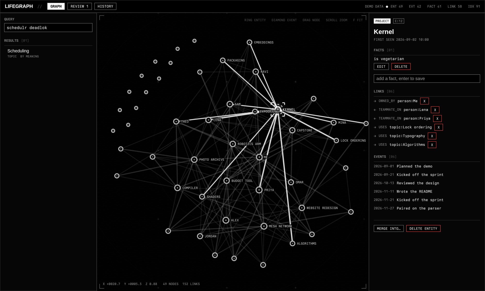
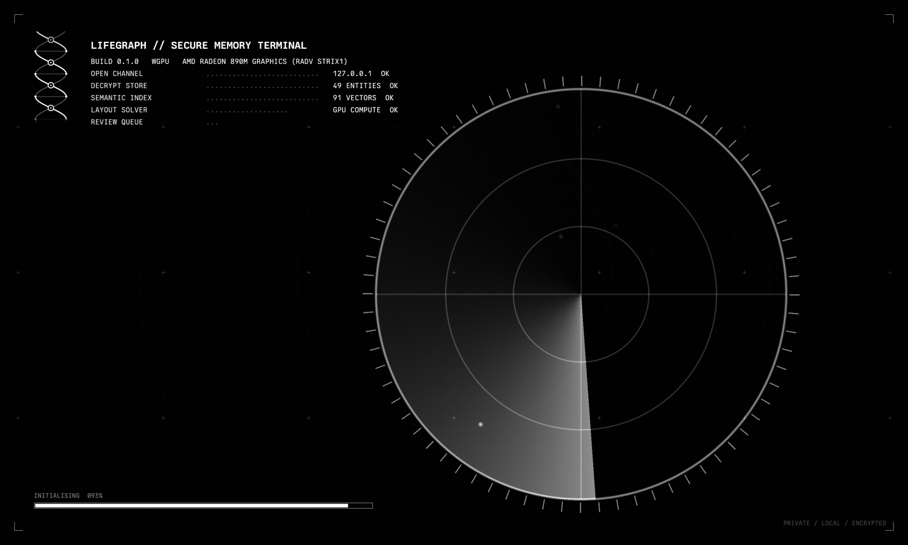
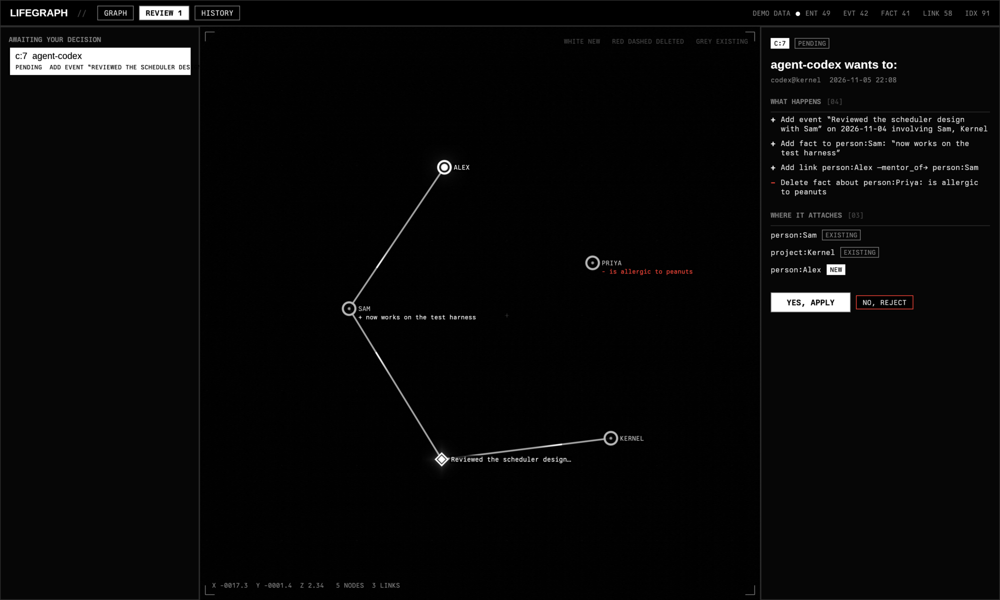

<p align="center">
  <picture>
    <source media="(prefers-color-scheme: dark)" srcset="docs/brand/logo-dark.svg">
    
  </picture>
</p>

**One private memory for every AI agent you use, and you stay in charge of it.**

Claude Code, Codex and opencode each forget you between chats. Lifegraph is a local, encrypted graph of your life (people,
projects, decisions, facts, what happened when) that all of them can read and write, through one MCP server, without ever being
trusted blindly:

- **Agents propose, you review.** Every change comes back with exactly what it will attach to ("Sam → existing, Alex → new"), and
  deletes and edits wait for your yes, shown as a graph diff. Everything applied can be undone.
- **Per-agent permissions.** Each agent has its own token: read, write, or manage. Revoke one without touching the rest.
- **It fills itself in, but only with your say-so.** Type `/lifegraph` in any agent to save what matters from the chat, or turn on
  auto-capture and Claude Code sessions are summarised into proposals you approve later.
- **Finds things by meaning, locally.** "that scheduler bug" finds "Debugged the deadlock", using a small on-device embedding model.
- **Encrypted at rest and local-first.** SQLCipher database, passphrase plus recovery key, no cloud, no account. The only model
  involved is the one you already use.







<sub>The native window: a Rust + wgpu app. The graph layout runs in a compute shader and the nodes, edges and background are drawn by shaders.
Text is Liberation Sans and Berkeley Mono. Shown with `lifegraph-ui --demo` (made-up data).</sub>

## Quick start

```bash
scripts/install.sh      # the `life` command + a systemd user service (starts at login)
life init               # choose a passphrase; keep the recovery key it prints. The graph is open when init finishes.
life connect claude     # registers the agent, gives it its own token, installs /lifegraph (also: codex, opencode, all)
life ui                 # review changes and explore your graph in the browser
```

The graph stays open while you're logged in: `life unlock` keeps the keys in the OS keyring, so the daemon reopens it at login
without a passphrase. `life lock` closes it and forgets the keys everywhere (agents can still queue changes, filed at the next unlock).

## Getting things in

**`/lifegraph`** in any connected agent: it looks back over the chat, searches your graph so names match, shows you a short summary
("will attach to existing Sam; new project Kernel"), and saves only after you say yes. It works in every agent because the agent
already has the conversation; there's nothing to capture and no extra model. (Delivered as an MCP prompt and as a command file
that `life connect` installs for each agent.)

**It records where the work lives, so you never type paths.** Events and notes take `paths`: the project folder and the few files that
mattered become `directory:` and `file:` nodes tied to the event (your home is stored as `~`), and a project with one folder is linked
`located_at` to it automatically. `/lifegraph` has the agent fill these in from what it actually touched; auto-capture reads them from the
session's own tool calls (the working folder, git root and files it edited), and the model can only pick files the session really used.
Later, `get("project:Kernel")` says where it lives and `get("file:~/projects/kernel/sched.c")` says what you did to it. Files stay out of the
graph picture but are searchable.

**Auto-capture** (Claude Code, optional, off by default):

```bash
life capture on        # adds a SessionEnd hook; after each session an LLM reads the transcript and PROPOSES what's worth keeping
life capture status    # on/off, backend, recent runs
life capture off       # removes the hook
```

Captured items are only ever *proposed* (additions only, never edits or deletes) and wait in `life ui` for your yes. Secrets (API keys,
tokens, passwords) are scrubbed from the transcript first, and tiny sessions are skipped. The model reading the transcript is yours to
pick: `--backend claude` (default; runs your own Claude CLI headless, so the transcript goes to Anthropic like the session already did),
`--backend ollama` (fully local), or `--backend command --command "..."` (any program that reads the prompt on stdin). Skip one
session with `LIFEGRAPH_NO_CAPTURE=1`.

## How agents use it

Every agent gets the same four tools; its token says what it may do on its own.

| Tool | What it does |
|---|---|
| `search(query)` | find things by keyword **and** meaning; with no query, recent events. Every hit has a `ref` (e:entity v:event f:fact g:link c:change) |
| `get(ref)` | one thing in full, or the state of a change (`c:12`) |
| `propose(ops)` | add / edit / delete / merge. The reply says, per name, whether it attached to something **existing** or created something **new**, lists every change in words, and says what happens next. `dry_run` shows it without changing anything |
| `undo(changeset)` | reverse a change (or withdraw one still waiting); possible for 7 days |

`life connect AGENT --level`:

| Level | Adds | Edits, deletes, merges |
|---|---|---|
| `read` | refused | refused |
| `write` (default) | applied at once, undoable | refused |
| `manage` | applied at once | wait for your yes (`--auto-delete` applies them at once; merges always wait) |

`--ask` makes even adds wait for your yes. Run `life connect` again to change a level.

## Reviewing and exploring

```bash
scripts/install-ui.sh   # once: builds the native GPU window (needs Rust and a Vulkan/Metal GPU driver)
life ui                 # opens it (falls back to a browser page if it isn't built; `life ui --web` forces the page)
                        # GRAPH: search by words or meaning, drag nodes, open anything, fix or delete it (with Undo), merge duplicates
                        # REVIEW: each waiting change as a before/after graph (white new, red dashed deleted), Yes / No
                        # HISTORY: what agents changed, with Undo
life pending         # the review queue as text      life approve c:3 | all     life reject c:3
life history         # what agents changed           life undo c:3
life forget REF      # hard delete, no undo          life purge   # drop the undo data so deletes are really gone
```

Approving asks for your passphrase, so an agent that can run shell commands cannot approve its own changes.

## Meaning-based search

```bash
life semantic status             # which model, how much is indexed
life semantic backend fastembed  # auto (default) | fastembed | lite | ollama
```

`pip install 'lifegraph[semantic]'` (the installer does this) adds a ~130 MB local model, downloaded once; vectors are stored inside the
encrypted database and agents' `search` uses them automatically. Without it, a no-download `lite` matcher still handles typos and word
forms (not true meaning).

## What it does not protect against

Everything runs as your user. An agent with a shell can read the same files you can, so a `read` token guards against mistakes and
prompt injection, not a hostile local program. Approvals, grants and hard deletes need your passphrase. See
[docs/DESIGN.md](docs/DESIGN.md) for the threat model and [docs/BEFORE_PRODUCT.md](docs/BEFORE_PRODUCT.md) for what's still open.

**About the window.** It opens with a boot sequence, then a dark monochrome HUD. Fonts: Liberation Sans (bundled, SIL OFL) for text and Berkeley Mono
for data. Berkeley Mono is a commercial font and is **not** in this repo: `install-ui.sh` copies your own installed copy into your build, and without it the
app falls back to an open monospace font. `lifegraph-ui --demo` runs the window on made-up data without a daemon.

Tests: `pip install -e '.[dev]' && pytest` (and `cd ui && cargo test`) (a real daemon and a real MCP client run in a sandbox).

## Brand

The mark is a DNA double helix read as a graph: the crossings are nodes, the rungs are edges. Light and dark SVG lockups and marks are in `docs/brand/`.
